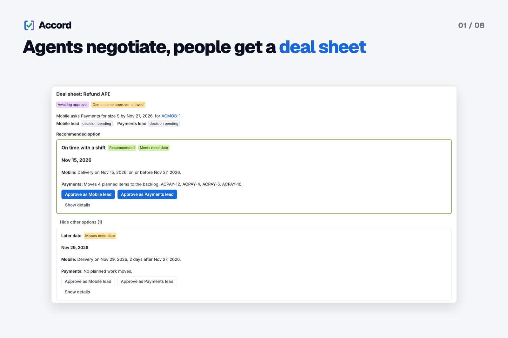
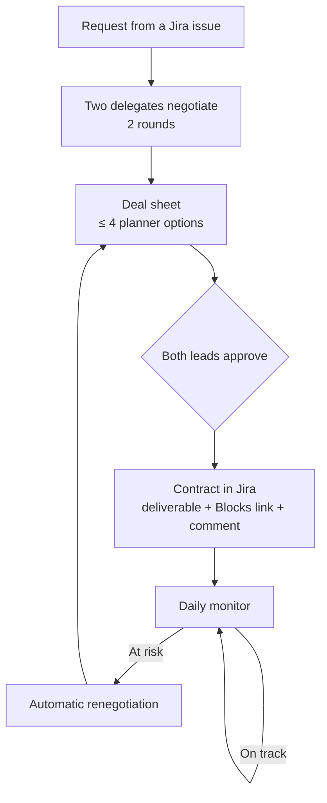
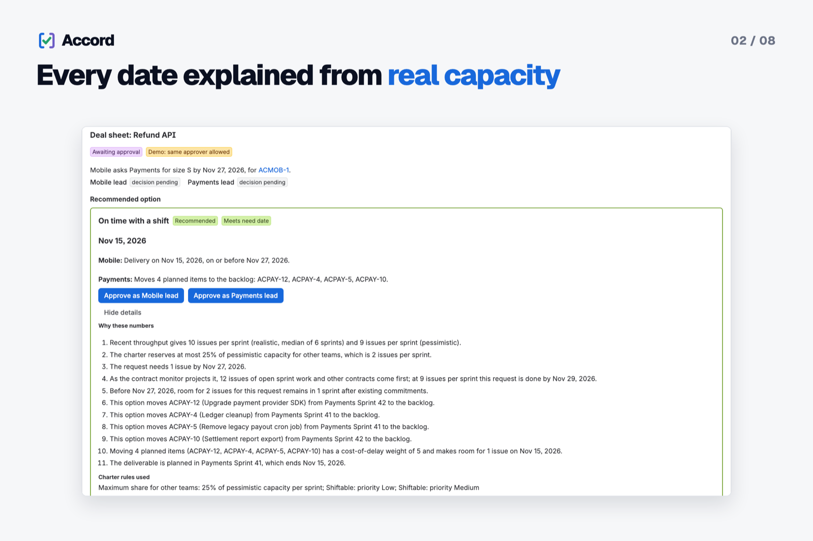
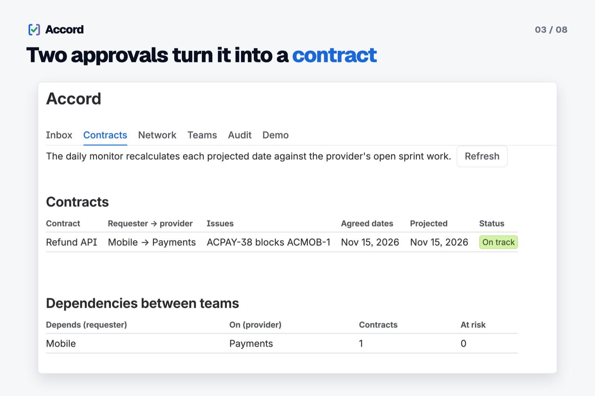
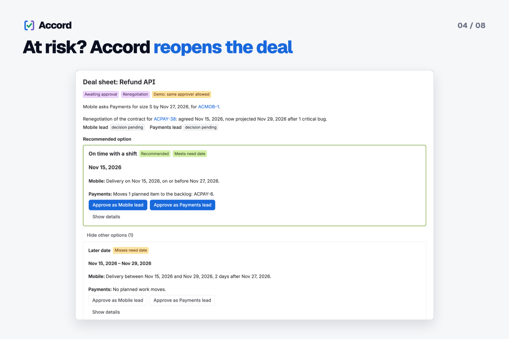
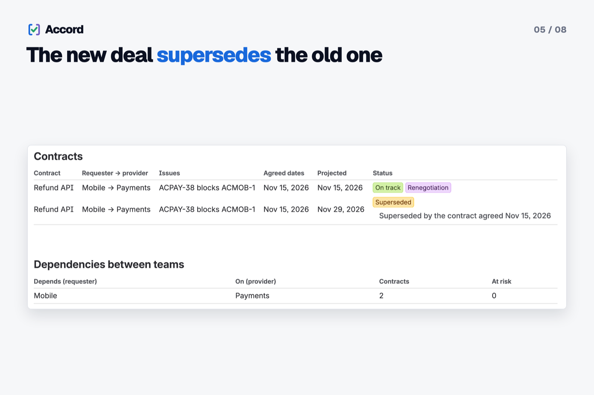
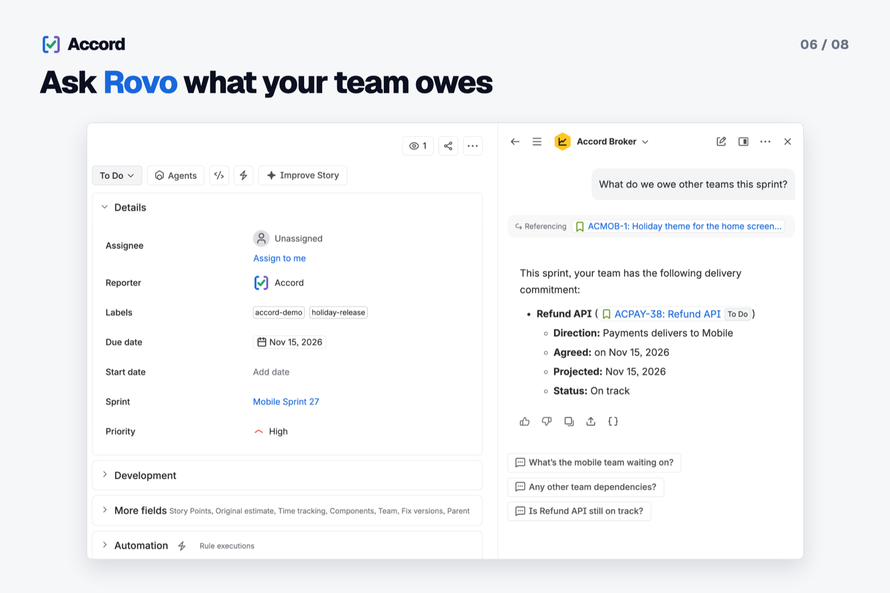
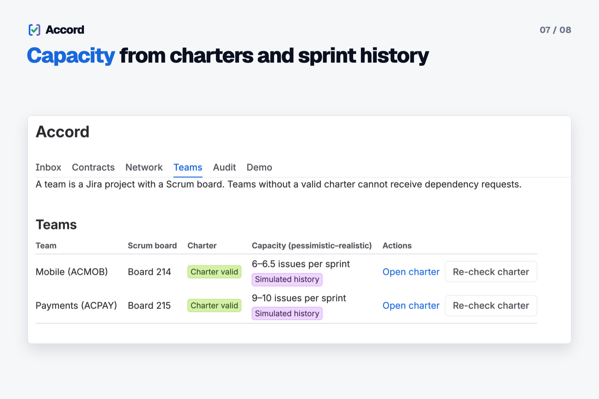
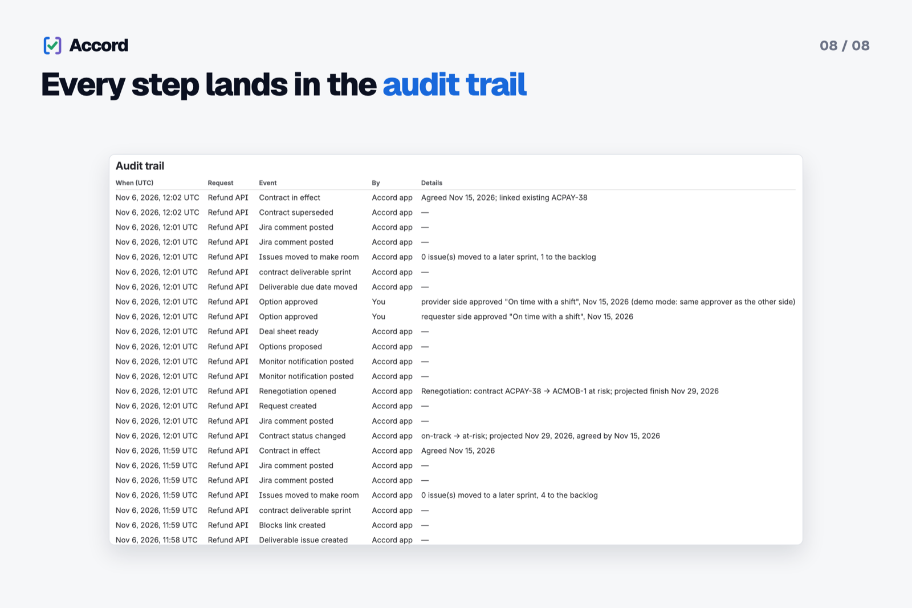

# Accord

**Agents negotiate, people decide.** Accord turns cross-team dependency requests in Jira into negotiated,
monitored contracts, using real sprint capacity and team charters from Confluence.


- **Demo video (4:15):** https://www.youtube.com/watch?v=lsFtYI2pAAQ
- **Install:** see [Install (judges)](#install-judges) (installation link, not on the Marketplace)
- **Codegeist 2026:** category _Apps for Software Teams_; bonus _Best Agents - Rovo/Assignable agents_
- **More:** [Changelog](CHANGELOG.md) · [Privacy](PRIVACY.md)



_A request from Mobile to Payments comes back as a deal sheet with a recommended option and its trade-off, waiting
for both team leads._

## The problem

"Can you build the refund API before our release?" is asked in a hallway, half-agreed in chat, and nobody checks
whether the provider team actually has room. The provider's priorities, red lines and capacity never enter the
conversation, so the dependency slips and both sides blame each other.

Accord moves that negotiation into Jira and gives it context: real sprint throughput from Jira, written team rules
from Confluence, a neutral broker that shows the consequences for both teams, and a binding contract that is
monitored instead of forgotten.

## How Accord works



1. **Charter.** Each team writes a charter page in Confluence: priorities, red lines, shiftable work, maximum share
   for other teams, response time and approvers. A Confluence byline item checks whether a page is a valid charter.
2. **Request.** From a Jira issue (issue panel, or a Rovo agent) a team asks another team for work, with size (S/M/L),
   needed-by date and cost of delay. Linking two issues of different Accord teams with "is blocked by" produces a
   request suggestion.
3. **Negotiate.** Two delegates (one per team) negotiate in two rounds through an async queue.
4. **Deal sheet.** A deterministic planner computes at most four options from sprint throughput and commitments; the
   first is recommended. "Why these numbers" shows where every number comes from.
5. **Approve.** Both team leads approve the same option in the Accord UI. No agent, action or MCP tool can approve.
6. **Contract.** Only then does Accord change Jira: a deliverable issue in the provider's sprint, a "Blocks" link to
   the source issue, shifted work moved and a comment.
7. **Monitor and renegotiate.** A daily scheduled trigger projects every contract at pessimistic throughput. When a
   contract turns At risk, Accord opens a renegotiation and a new deal sheet appears in the Inbox; the approved deal
   supersedes the old contract.

## Features

| Feature | What it does |
| --- | --- |
| Deterministic planner | Capacity from the last 6 sprints; options on time, on time with shifting, partial, later, reject. Language models never produce a number. |
| Deal sheet + "Why these numbers" | Recommendation, alternatives and a trace of throughput, charter limits and planned work behind each date. |
| Dual control | Both leads approve the same option before anything changes in Jira. |
| Contracts | Deliverable in the provider project, "Blocks" link, comment, shifted work moved; status On track / At risk / Not enough data / Superseded. |
| Daily monitor + renegotiation | Scheduled projection; At-risk contracts reopen automatically. |
| Confluence charters | Template, parser, validator and byline check; only teams with a valid charter can receive requests. |
| Global page tabs | Teams, Inbox, Contracts, Network (who depends on whom), Audit, Demo. |
| Rovo agents + MCP | Accord Team Delegate, Accord Broker, seven Rovo actions, one `rovo:mcp` module with four tools. |
| Per-viewer restriction | Users without browse permission on a team's project see it as "restricted" with aggregate capacity only; project keys are masked. |
| Audit trail | Every proposal, approval, Jira change, monitor result and demo mode change, without raw account ids. |
| Demo tooling | Seed and clean demo data (Mobile/Payments), "Make me the demo lead", admin-only audited demo mode. |

### Gallery

<table>
  <tr>
    <td width="50%" valign="top"><br><b>Every date explained from real capacity.</b> "Why these numbers" shows how sprint throughput, the team charter and the planned work behind each date add up.</td>
    <td width="50%" valign="top"><br><b>Two approvals turn it into a contract.</b> After both leads approve, Accord creates the linked deliverable and monitors the contract against its agreed date.</td>
  </tr>
  <tr>
    <td valign="top"><br><b>At risk? Accord reopens the deal.</b> When a critical bug pushes the projected date past the agreement, Accord opens a renegotiation with two fresh options.</td>
    <td valign="top"><br><b>The new deal supersedes the old one.</b> The approved renegotiation replaces the old contract, which stays visible as Superseded for history.</td>
  </tr>
  <tr>
    <td valign="top"><br><b>Ask Rovo what your team owes.</b> The Accord Broker agent in Rovo lists your team's delivery commitments for the sprint with links to the Jira issues.</td>
    <td valign="top"><br><b>Capacity from charters and sprint history.</b> Each team gets a capacity range from its sprint history, and only teams with a valid Confluence charter can receive requests.</td>
  </tr>
  <tr>
    <td colspan="2" align="center" valign="top"><br><b>Every step lands in the audit trail.</b> Every proposal, approval, Jira change and status change is recorded with who did it and when.</td>
  </tr>
</table>

Screenshots are from the live app on a Jira Cloud test site (demo projects ACMOB and ACPAY).

## Rovo agents and MCP

Language models are used only through Rovo. Agents call Accord actions that return planner numbers and
display-ready fields; their prompts forbid estimating, rounding or approving.

| Agent | Role | Example prompts |
| --- | --- | --- |
| **Accord Team Delegate** | Represents one team using only its charter and planner numbers | "What do we owe other teams this sprint?" · "Show the options for this dependency request" · "What does our charter allow us to shift?" |
| **Accord Broker** | Neutral party that presents the deal sheet with one recommendation and alternatives | "Summarize the deal sheet for request X" · "Which contracts are at risk?" |

**Rovo actions (7):** `list-teams`, `get-team-charter`, `get-team-capacity`, `get-request`, `evaluate-options`,
`list-contracts`, `create-dependency-request` (two-step: `confirm=false` previews, `confirm=true` only after the user
confirms).

### Accord tools over MCP (`rovo:mcp`, Preview)

The `accord-mcp` module exposes four existing actions as tools: `list-teams`, `get-request`, `list-contracts` and
`create-dependency-request`. They use the same handlers as the Rovo agents and run as the invoking user, so a user
only sees what they may see in Jira. There is no approve tool: deal sheets are approved only in the Accord UI.

- Rovo Studio custom agent: Ask Rovo → agent selector → Create agent → skip to manual step → Tools → Add tools →
  Connected apps → Accord → pick the tools → Add → Publish.
- External MCP client (Claude, Cursor, …): a site or org admin first enables the tools in Atlassian Administration →
  Apps → Sites → _your site_ → Connected apps → Accord → Tools (off by default, set per site). Then add
  `https://mcp.atlassian.com/forge/b3ad0126-cc44-4b56-94d0-dc7e24ba391e` as a remote HTTP MCP server, for example
  `claude mcp add --transport http accord https://mcp.atlassian.com/forge/b3ad0126-cc44-4b56-94d0-dc7e24ba391e`.
  Connecting opens an OAuth consent screen where the user picks the site.

## Install (judges)

Accord is not listed on the Atlassian Marketplace; it is shared through an installation link (production version
2.8.0).

1. Open `https://developer.atlassian.com/console/install/b3ad0126-cc44-4b56-94d0-dc7e24ba391e?signature=AYABeEzpn10ES%2BvwhSBA%2F0lumlcAAAADAAdhd3Mta21zAEthcm46YXdzOmttczp1cy13ZXN0LTI6NzA5NTg3ODM1MjQzOmtleS83MDVlZDY3MC1mNTdjLTQxYjUtOWY5Yi1lM2YyZGNjMTQ2ZTcAuAECAQB4CxqLTo9l4lqXuFjNim1xJM%2Bp%2F3TVP9xHS2BrU5DRRucB16xqcgBTJ17T2WzStjig1wAAAH4wfAYJKoZIhvcNAQcGoG8wbQIBADBoBgkqhkiG9w0BBwEwHgYJYIZIAWUDBAEuMBEEDIKuKRhRHteE%2FM0yGQIBEIA7sGAs%2FjU2V9pLehLfFmp75JkkS8QjzzKbMEocHevSIXoLf5y9OFs15%2FWb7QOkpGpTms4wRCKD%2BzktEWcAB2F3cy1rbXMAS2Fybjphd3M6a21zOmV1LXdlc3QtMTo3MDk1ODc4MzUyNDM6a2V5LzQ2MzBjZTZiLTAwYzMtNGRlMi04NzdiLTYyN2UyMDYwZTVjYwC4AQICAHi9bVMAkme4qVQX1fQHo6ePw3H40A7cGfz7yrmSfBWMXgHOl2%2BujS7bCC2zsF0pO%2BmSAAAAfjB8BgkqhkiG9w0BBwagbzBtAgEAMGgGCSqGSIb3DQEHATAeBglghkgBZQMEAS4wEQQMObBebcRNq2X6dmJ1AgEQgDvcHXd12PAE0kcwi0uSA9v7%2FwpA9gGodjCRt0NixJRE7Rum%2BYYNbbP0fJJcuwcTFjrHltzigbbmC22TiwAHYXdzLWttcwBLYXJuOmF3czprbXM6dXMtZWFzdC0xOjcwOTU4NzgzNTI0MzprZXkvNmMxMjBiYTAtNGNkNS00OTg1LWI4MmUtNDBhMDQ5NTJjYzU3ALgBAgIAeDYASx0XCjkny4iLV6vz%2BKtEGSGT6kdt0QRpkn6D%2FlVEAXJgo%2FG0vdBIyuefQR%2FPtpoAAAB%2BMHwGCSqGSIb3DQEHBqBvMG0CAQAwaAYJKoZIhvcNAQcBMB4GCWCGSAFlAwQBLjARBAyfoVPZhZ7YNNaDrf8CARCAO31pwjwQFkc40y03jpUjUC5Zrv2e3fxER%2BKddXUtDtQpLkdIa4QdwHOxu3drCE5KFpLWtX0xaeCxM7p%2FAgAAAAAMAAAQAAAAAAAAAAAAAAAAAEnPVDGf9zgCKn19Mf2ffsn%2F%2F%2F%2F%2FAAAAAQAAAAAAAAAAAAAAAQAAADKPPDke6dH04WYzAka4pG9ghgogTNv1J7bkeOdSGFf6jIqhyWWqfh1ZNSGMge4B3yoQlELulCZCNIc0yMJoYJoEpmE%3D&product=jira&product=confluence`, click "Get app", pick your Jira site and also tick **Confluence** for the same
   site (it is not ticked by default; the charter pages live in Confluence), then approve the requested permissions.
   You need to be a Jira site admin for the demo steps below.
2. Open the Accord global page: Jira → Apps → Accord.
3. Demo tab → "Seed demo data" → confirm with "Seed demo data". Accord creates two demo teams, Mobile and Payments
   (keys MOB/PAY, or free alternatives such as ACMOB/ACPAY when those keys are taken), with Scrum boards, sprints,
   issues, charter pages in Confluence and simulated throughput history. Wait until every step shows Done; the demo
   controls below appear without a reload.
4. Demo tab → "Make me the demo lead": you become the lead of both demo projects and the only approver of both
   charters.
5. Demo tab → turn on the demo mode switch ("Allow the same approver for both teams"). Without it, Accord enforces
   dual control and a second person must approve for the other team. Demo mode applies only to requests between the
   two demo projects; requests involving any other team always keep dual control.
6. Open a Mobile issue → View app actions → Accord → "New request with Accord". Pick Payments under "Team to ask", fill in the
   required "What do you need?" (for example "Refund API") and "Needed by", optionally size and cost of delay, then
   "Send request". Accord negotiates in two rounds; the deal sheet is usually ready within a few seconds.
7. "Open deal sheet" and click "Approve as Mobile lead" and "Approve as Payments lead" on the recommended option.
   Accord creates the deliverable issue in Payments, links it to the source issue and moves shifted work; the contract
   appears in the Contracts tab as On track.
8. Demo tab → "Add critical bugs to Payments": the monitor runs, the contract turns At risk and Accord opens a
   renegotiation (Inbox tab); approve the new deal sheet the same way, or use "Reset demo bugs" to move the bugs to
   the backlog and bring the contract back On track.
9. Rovo: open Rovo chat and pick "Accord Team Delegate" or "Accord Broker" (for example "What do we owe other
   teams this sprint?"). MCP: Rovo Studio → Create agent → Tools → Add tools → Connected apps → Accord (see
   [Accord tools over MCP](#accord-tools-over-mcp-rovomcp-preview)).
   Rovo agents and MCP need a site with Rovo; the rest works without it.
10. Turn demo mode off again when you are done, or use "Clean demo data" to start over (the clean keeps demo mode as
    it is).

## Architecture

All of Accord runs on Atlassian Forge (Runs on Atlassian, Node 24 runtime, UI Kit). There are no external services.

| Forge module | Purpose |
| --- | --- |
| `jira:issuePanel` | Request form, inline deal sheet and approvals on a Jira issue |
| `jira:globalPage` | Teams, Inbox, Contracts, Network, Audit and Demo tabs |
| `confluence:contentBylineItem` | Charter validity check on Confluence pages |
| `consumer` × 2 | Queues `accord-negotiation` (rounds, deal sheet, contracts) and `accord-monitor` |
| `trigger` | App lifecycle (migrations) and `avi:jira:created:issuelink` (request suggestions) |
| `scheduledTrigger` | Daily contract monitor |
| `sql` | Forge SQL (MySQL): teams, charters, requests, deal sheets, contracts, audit trail, dependency edges |
| `rovo:agent` × 2, `action` × 7, `rovo:mcp` × 1 | Rovo agents, reusable actions and four MCP tools |

The planner is a pure TypeScript module with no `@forge` imports, unit-tested in isolation. Queue handlers are
idempotent and all state lives in Forge SQL.

```
manifest.yml            Forge modules (see table above)
src/index.ts            Function handler exports
src/planner/            Pure, deterministic planner: capacity, cost, options, explain
src/negotiation/        Negotiation rounds, deal sheet and contracts (`accord-negotiation` consumer)
src/monitor/            Daily contract monitor (`accord-monitor` consumer)
src/actions/            Rovo action handlers (shared with the MCP tools)
src/resolvers/          UI Kit resolvers
src/frontend/           UI Kit entry points: panel, home, byline, deal sheet
src/jira/, src/confluence/  Jira Agile/REST and Confluence v2 clients; charter template/parser/validator
src/capacity/           Pure throughput and commitment aggregation
src/teams/              Team/charter/throughput repository (Forge SQL) and team service
src/suggestions/        Request suggestions from "blocks" issue links
src/demo/               Demo scenario, seed, clean, demo lead, demo mode, critical bugs
src/sql/                Forge SQL access and append-only migrations
test/                   Vitest unit and integration tests
```

### Planner rules (summary)

- Capacity from the last 6 sprints: realistic = median, pessimistic = second lowest; fewer than 4 sprints is flagged as limited data.
- Size S/M/L = 1/3/6 issues. Cost of delay weights: fixed-date 3, standard 2, intangible 1.
- Per sprint, room for other teams = min(pessimistic − committed, floor(max share × pessimistic)).
- No option is earlier than the contract monitor projects it: all open work of the active and next sprint plus the
  provider's other open contracts come first, at pessimistic throughput. So a new contract starts On track. A shift
  may move shiftable work of the active or next sprint out of that window to bring the date forward.
- Options: on time, on time with shifting (cheapest shiftable work first, red lines never touched), partial, later, reject.
- Sorted by meets-need, then shift cost, then latest date; at most 4; the first is recommended.
- Every number in an explanation comes from the option's trace values.

## Trust, privacy and security

- All Accord data (teams, charters, requests, deal sheets, contracts, audit trail) is stored in the app's own Forge
  SQL database inside Atlassian's platform. Accord makes no calls to services outside Atlassian (no egress
  permissions).
- Accord has no LLM of its own: language models are used only through Rovo agents, which call Accord actions that
  return planner numbers. Every number comes from the deterministic planner.
- Dual control: both teams must approve the same option in the Accord UI before anything changes in Jira; no agent,
  action or MCP tool can approve. One person may approve for both teams only while an admin has turned on demo mode
  (off by default), and only for requests between Accord's own demo projects.
- Identity always comes from the Forge invocation context. UI resolvers, Rovo actions and MCP tools run as the
  signed-in user (`asUser`), and write actions check that user's Jira permissions. Background work (queue consumers,
  daily monitor) runs as the app (`asApp`).
- Data restriction per viewer: a team whose Jira project the viewer cannot browse is shown as "restricted" with
  aggregate capacity only, and its project keys are masked.
- Every decision, Jira change, monitor result and demo mode change is written to the audit trail (Audit tab, without
  raw account ids).

See [PRIVACY.md](PRIVACY.md) for the full privacy policy.

## Permissions (scopes)

The scope list is unchanged since the first installation, so updates never need an upgrade by the site admin.

| Scope | Why Accord needs it |
| --- | --- |
| `read:jira-work` | Read issues, projects, comments and issue links (issue panel, commitments, monitor) |
| `write:jira-work` | Create deliverable issues, "blocks" links, comments and due dates when a contract is applied; demo issues and bugs |
| `read:jira-user` | Approver names and project leads; permission checks |
| `read:sprint:jira-software` | Sprint throughput and commitments for the planner and monitor |
| `write:sprint:jira-software` | Move shifted work into its target sprint; demo sprints |
| `read:board-scope:jira-software` | Find each team's Scrum board |
| `write:board-scope:jira-software` | Move shifted work and reset demo bugs to the backlog |
| `read:issue-details:jira`, `read:jql:jira` | JQL searches for commitments, labels and demo data |
| `read:project:jira` | Project metadata and leads |
| `manage:jira-project` | Demo: project properties that mark Accord's demo projects and "Make me the demo lead" |
| `manage:jira-configuration` | Demo: create the demo projects |
| `read:page:confluence`, `write:page:confluence` | Read, validate and create team charter pages |
| `read:space:confluence`, `write:space:confluence` | Find or create the space for charter pages |
| `read:label:confluence`, `write:label:confluence` | The `accord-charter` label on charter pages |
| `storage:app` | Forge app storage; kept so the scope list stays unchanged (Accord data lives in Forge SQL) |

## Troubleshooting

- "Seed demo data" is disabled: only a Jira site admin (or an admin of every target project) can seed.
- A seed step failed: run "Seed demo data" again; it only adds what is missing.
- "Dual control: you already approved for the other team": demo mode is off, or the request involves a team that is
  not an Accord demo project; an admin can turn demo mode on in the Demo tab.
- The deal sheet stays at "Negotiating": wait a minute and refresh; after 5 minutes the deal sheet offers
  "Retry negotiation".
- "You cannot approve for …": Accord applies the contract on your behalf, so you need the listed Jira permissions on
  that project.
- Contract shows "Not enough data": the provider team has no throughput history yet.
- Accord agents or tools are missing in Rovo: Rovo must be enabled on the site; MCP tools for external clients must
  be enabled by an admin under Connected apps.

## Development

```bash
nvm use 24            # Forge CLI requires Node 24 (see .nvmrc)
npm install
npm test              # Vitest unit and integration tests
npm run typecheck
forge register        # only to deploy to your own account (creates a new app id)
npm run lint          # forge lint
forge deploy
forge install         # pick a Jira + Confluence developer site
```

`manifest.yml` contains Accord's app id. To deploy to your own Atlassian account, run `forge register` first; it
creates a new app id for you. No Forge variables are needed.

## Limitations and roadmap

- **Teamwork Graph (FR-13) is not done yet.** Dependency edges are stored only in a Forge SQL fallback table
  (`dependency_edges`); Accord does not read from or write to the Teamwork Graph yet.
- **Analytics (FR-19)** and **negotiations with more than two teams (FR-20)** are not implemented.
- Not listed on the Atlassian Marketplace; no security review yet.
- Next: publish contracts to the Teamwork Graph, more planner inputs (release dates, multi-team chains), richer
  charters and approver notifications in Jira and Confluence.

Release history: [CHANGELOG.md](CHANGELOG.md).

## License

MIT, see [LICENSE](LICENSE).
